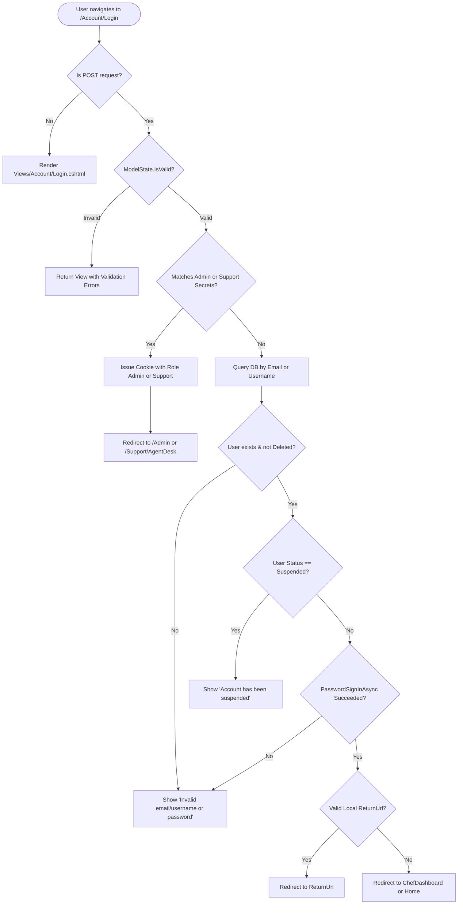

# Complete Guide & Deep Dive: `AccountController.cs`

This document explains every single concept, class, dependency, method, return type, security pattern, and line of code inside [AccountController.cs](file:///home/mariam.gamal/Mariam/NET%20Track/depi%202026/graduation%20project/depi-gp-home-food-ecommerce/depiR5gp/Controllers/AccountController.cs).

---

## Table of Contents
1. [Architectural Overview & The Primary Constructor](#1-architectural-overview--the-primary-constructor)
2. [Built-in Classes & Injected Dependencies: What They Are & What They Store](#2-built-in-classes--injected-dependencies-what-they-are--what-they-store)
   - [Controller (Microsoft.AspNetCore.Mvc)](#controller-microsoftaspnetcoremvc)
   - [UserManager<TUser> (Microsoft.AspNetCore.Identity)](#usermanagertuser-microsoftaspnetcoreidentity)
   - [SignInManager<TUser> (Microsoft.AspNetCore.Identity)](#signinmanagertuser-microsoftaspnetcoreidentity)
   - [RoleManager<TRole> (Microsoft.AspNetCore.Identity)](#rolemanagertrole-microsoftaspnetcoreidentity)
   - [IConfiguration (Microsoft.Extensions.Configuration)](#iconfiguration-microsoftextensionsconfiguration)
   - [Claims, ClaimsIdentity, and ClaimsPrincipal](#claims-claimsidentity-and-claimsprincipal)
   - [IdentityResult & SignInResult](#identityresult--signinresult)
   - [ModelState & TempData](#modelstate--tempdata)
   - [Action Return Types (IActionResult, ViewResult, RedirectResult)](#action-return-types-iactionresult-viewresult-redirectresult)
3. [Method-by-Method Detailed Walkthrough](#3-method-by-method-detailed-walkthrough)
   - [1. Login (GET)](#1-login-get)
   - [2. Login (POST) — Dual Auth: Secrets & Database](#2-login-post--dual-auth-secrets--database)
   - [3. Register (GET)](#3-register-get)
   - [4. Register (POST) — Security, Validation & Role Assignment](#4-register-post--security-validation--role-assignment)
   - [5. Logout (POST & GET)](#5-logout-post--get)
   - [6. ForgotPassword (GET & POST)](#6-forgotpassword-get--post)
   - [7. ResetPassword (GET & POST)](#7-resetpassword-get--post)
   - [8. AccessDenied](#8-accessdenied)
4. [Security Patterns & Defenses in AccountController](#4-security-patterns--defenses-in-accountcontroller)
   - [CSRF Protection ([ValidateAntiForgeryToken])](#csrf-protection-validateantiforgerytoken)
   - [Open Redirect Attack Prevention (Url.IsLocalUrl)](#open-redirect-attack-prevention-urlislocalurl)
   - [Timing-Safe Password Verification & PBKDF2 Hashing](#timing-safe-password-verification--pbkdf2-hashing)
   - [Enumeration Attack Mitigation](#enumeration-attack-mitigation)
5. [Summary Flowchart](#5-summary-flowchart)

---

## 1. Architectural Overview & The Primary Constructor

At the top of `AccountController.cs`:

```csharp
namespace depiR5gp.Controllers;

public class AccountController(
    UserManager<AppUser> userManager,
    SignInManager<AppUser> signInManager,
    RoleManager<IdentityRole<int>> roleManager,
    IConfiguration configuration) : Controller
```

### What is a C# 12 Primary Constructor?
In traditional C# code, you had to define private fields (`private readonly UserManager<AppUser> _userManager;`) and assign them inside a constructor function.
With C# 12 **Primary Constructors**, the parameters declared directly on the class declaration (`public class AccountController(...)`) are automatically captured by the compiler and are accessible anywhere inside the entire class methods!

### Inheritance from `Controller`
`AccountController` inherits from `Microsoft.AspNetCore.Mvc.Controller`. This inheritance equips our class with:
- `View()` to render Razor views.
- `RedirectToAction()` to send HTTP 302 redirects.
- `LocalRedirect()` to safely navigate to internal URLs.
- `ModelState` to manage validation errors.
- `TempData` to pass one-time messages across redirects.
- `HttpContext` to inspect the incoming HTTP request and modify the outgoing HTTP response (e.g., writing auth cookies).
- `User` to access the current authenticated user's claims.

---

## 2. Built-in Classes & Injected Dependencies: What They Are & What They Store

### `Controller` (`Microsoft.AspNetCore.Mvc`)
- **What it is**: The fundamental base class for ASP.NET Core MVC controllers handling HTTP requests and HTML/JSON responses.
- **What it holds**:
  - `HttpContext`: The encapsulation of all HTTP-specific information about an individual HTTP request/response.
  - `Request`: The incoming `HttpRequest` (headers, cookies, query string, form body).
  - `Response`: The outgoing `HttpResponse` (status code, cookies, headers).
  - `ModelState`: The dictionary containing the state of model binding and validation.
  - `TempData`: The dictionary for passing temporary data across redirects (backed by session or cookies).
  - `User`: The `ClaimsPrincipal` representing the security context of the user making the request.

---

### `UserManager<TUser>` (`Microsoft.AspNetCore.Identity`)
- **What it is**: The central service in ASP.NET Core Identity for managing user accounts in storage.
- **What it does / stores**:
  - It does **not** store users in its own memory; instead, it delegates to an `IUserStore<TUser>` (backed by our EF Core `ApplicationDbContext` and the `AppUsers` SQL table).
  - Handles **cryptographic hashing**: Hashes passwords using `PasswordHasher<TUser>` (PBKDF2 with HMAC-SHA256 and unique cryptographic salt per user).
  - Enforces **Identity Options**: Password length, complexity, unique email, allowed characters in usernames.
  - Manages **Security Stamps**: Automatically generates and updates a GUID string whenever credentials change, invalidating existing cookies if needed.
  - Generates and verifies **Cryptographic Tokens**: Password reset tokens, email confirmation tokens, phone verification codes.
- **Key Methods Used in `AccountController`**:
  | Method | Return Type | Description |
  | :--- | :--- | :--- |
  | `FindByEmailAsync(email)` | `Task<AppUser?>` | Queries the database for a user matching the normalized email. Returns `null` if not found. |
  | `FindByNameAsync(userName)` | `Task<AppUser?>` | Queries the database for a user matching the normalized username. Returns `null` if not found. |
  | `CreateAsync(user, password)` | `Task<IdentityResult>` | Validates user data, hashes the password, and inserts the user into the database via EF Core. |
  | `AddToRoleAsync(user, roleName)` | `Task<IdentityResult>` | Creates a record in the `AspNetUserRoles` link table associating the user with the specified role. |
  | `IsInRoleAsync(user, roleName)` | `Task<bool>` | Checks if the user is linked to the specified role. |
  | `GeneratePasswordResetTokenAsync(user)` | `Task<string>` | Generates a time-sensitive, single-use, cryptographically signed token for password reset. |
  | `ResetPasswordAsync(user, token, newPassword)` | `Task<IdentityResult>` | Verifies the reset token. If valid, updates the password hash and security stamp. |
  | `Users` | `IQueryable<AppUser>` | Exposes an EF Core queryable interface to run custom LINQ queries (e.g. `await userManager.Users.AnyAsync(...)`). |

---

### `SignInManager<TUser>` (`Microsoft.AspNetCore.Identity`)
- **What it is**: The service responsible for authenticating users, managing sign-in sessions, and handling authentication cookies.
- **What it does / stores**:
  - Uses an `IUserClaimsPrincipalFactory<TUser>` to turn an `AppUser` entity into a `ClaimsPrincipal`.
  - Communicates with the ASP.NET Core Cookie Authentication middleware (`IdentityConstants.ApplicationScheme`).
  - Writes and decrypts the encrypted authentication cookie (`.AspNetCore.Identity.Application`).
- **Key Methods Used in `AccountController`**:
  | Method | Return Type | Description |
  | :--- | :--- | :--- |
  | `PasswordSignInAsync(user, password, isPersistent, lockoutOnFailure)` | `Task<SignInResult>` | Verifies the plain password against the stored password hash. If correct, issues an authentication cookie. |
  | `SignInAsync(user, isPersistent)` | `Task` | Directly signs in a user (issues an auth cookie) without asking for a password (used immediately after registration). |
  | `SignOutAsync()` | `Task` | Instructs the browser to delete the authentication cookie and clears the session. |

---

### `RoleManager<TRole>` (`Microsoft.AspNetCore.Identity`)
- **What it is**: The service responsible for managing roles in the identity system.
- **Why `IdentityRole<int>`?**:
  - By default, ASP.NET Core Identity uses `string` (GUIDs) as primary keys.
  - In our project, our database tables use `int` IDs. Therefore, our roles are typed as `IdentityRole<int>`.
- **Key Methods Used in `AccountController`**:
  | Method | Return Type | Description |
  | :--- | :--- | :--- |
  | `RoleExistsAsync(roleName)` | `Task<bool>` | Checks the `AspNetRoles` table to see if a role (e.g., `"Customer"`, `"Chef"`) exists. |
  | `CreateAsync(role)` | `Task<IdentityResult>` | Inserts a new role into the `AspNetRoles` table. |

---

### `IConfiguration` (`Microsoft.Extensions.Configuration`)
- **What it is**: The central configuration provider in .NET.
- **What it stores**:
  - Provides hierarchical key-value configuration.
  - Merges values from:
    1. `appsettings.json`
    2. `appsettings.Development.json`
    3. `.NET User Secrets` (`dotnet user-secrets`) — local development
    4. Environment Variables — production (Azure App Service / Docker)
- **Usage in `AccountController`**:
  ```csharp
  var adminEmail = configuration["Admin:Email"] ?? "admin@homechef.eg";
  var adminPassword = configuration["Admin:Password"] ?? "Admin@123";
  ```
  This allows Admin and Support to log in without needing their personal data or passwords in the database!

---

### Claims, `ClaimsIdentity`, and `ClaimsPrincipal`
These three classes form the security core of .NET:

```
┌────────────────────────────────────────────────────────┐
│                   ClaimsPrincipal                      │  (The User / Passport Holder)
│  ┌──────────────────────────────────────────────────┐  │
│  │                  ClaimsIdentity                  │  │  (A Passport or Driver's License)
│  │  - Claim: NameIdentifier = "admin"               │  │
│  │  - Claim: Name = "Admin"                         │  │  (Individual facts / stamp marks)
│  │  - Claim: Email = "admin@homechef.eg"            │  │
│  │  - Claim: Role = "Admin"                         │  │
│  └──────────────────────────────────────────────────┘  │
└────────────────────────────────────────────────────────┘
```

1. **`Claim`** (`System.Security.Claims`):
   - A single statement about the user.
   - Consists of a **Type** and a **Value**.
   - Example: `new Claim(ClaimTypes.Role, "Admin")`.
2. **`ClaimsIdentity`** (`System.Security.Claims`):
   - A collection of claims bundled under an **Authentication Scheme** (e.g., `IdentityConstants.ApplicationScheme`).
   - If an identity has an authentication scheme, its `IsAuthenticated` property becomes `true`.
3. **`ClaimsPrincipal`** (`System.Security.Claims`):
   - The user entity itself. A principal can hold one or more identities.
   - In any controller action or Razor view, `User` or `HttpContext.User` is a `ClaimsPrincipal`.
4. **`AuthenticationProperties`** (`Microsoft.AspNetCore.Authentication`):
   - Options for the authentication session.
   - `IsPersistent = true` tells the browser to keep the cookie on disk across browser restarts ("Remember Me").
   - `IsPersistent = false` creates a session cookie that expires when the browser closes.
5. **`HttpContext.SignInAsync(...)`**:
   - Encrypts the `ClaimsPrincipal` into an authentication cookie, adds cryptographic signatures to prevent tampering, and appends the `Set-Cookie` header to the HTTP response.

---

### `IdentityResult` & `SignInResult`

#### `IdentityResult`
Returned by operations modifying identity data (like `userManager.CreateAsync`, `userManager.AddToRoleAsync`, `userManager.ResetPasswordAsync`):
- `result.Succeeded` (`bool`): `true` if the operation succeeded.
- `result.Errors` (`IEnumerable<IdentityError>`): List of errors if failed. Each error has:
  - `error.Code`: e.g., `"PasswordTooShort"`, `"DuplicateUserName"`.
  - `error.Description`: Friendly English message, e.g., `"Passwords must be at least 6 characters."`.

#### `SignInResult`
Returned by `signInManager.PasswordSignInAsync`:
- `result.Succeeded` (`bool`): `true` if password was correct and sign-in cookie was generated.
- `result.IsLockedOut` (`bool`): `true` if the account is locked due to too many failed attempts.
- `result.IsNotAllowed` (`bool`): `true` if the user is not allowed to sign in (e.g., unconfirmed email).
- `result.RequiresTwoFactor` (`bool`): `true` if 2FA code is needed.

---

### `ModelState` & `TempData`

#### `ModelState` (`ModelStateDictionary`)
- Tracks validation status of incoming parameters (from forms, query parameters, route values).
- `ModelState.IsValid` (`bool`): `true` if all data attributes (`[Required]`, `[EmailAddress]`, `[StringLength]`) and custom manual errors passed.
- `ModelState.AddModelError(key, message)`:
  - If `key` is a property name (e.g., `nameof(userVm.Email)`), the error appears next to that specific input field via `<span asp-validation-for="Email"></span>`.
  - If `key` is `string.Empty` or `""`, it is a **model-level error** and displays in the summary banner via `<div asp-validation-summary="ModelOnly"></div>`.

#### `TempData` (`ITempDataDictionary`)
- Temporary storage backed by the session cookie.
- Survives across **one HTTP redirect** (implements the **PRG: Post-Redirect-Get** pattern).
- Once read in the next request, it is automatically marked for deletion so it doesn't linger.
- Example:
  ```csharp
  TempData["SuccessMessage"] = "Your account has been created successfully!";
  return RedirectToAction("Index", "Home");
  ```

---

### Action Return Types: `IActionResult`, `ViewResult`, `RedirectResult`

Every action method returns an `IActionResult` (or `Task<IActionResult>` when asynchronous):

1. **`View(model)` -> `ViewResult`**:
   - Renders the `.cshtml` Razor template matching the action name (or specified view name) and returns HTTP 200 OK with HTML content.
2. **`RedirectToAction(action, controller)` -> `RedirectToActionResult`**:
   - Returns an **HTTP 302 Found** directing the user's browser to send a new GET request to the specified controller action.
3. **`LocalRedirect(returnUrl)` -> `LocalRedirectResult`**:
   - Redirects to a local URL path (e.g. `/Dishes/Details/5`). Throws an exception if the URL is external (preventing open redirect phishing attacks).

---

## 3. Method-by-Method Detailed Walkthrough

---

### 1. Login (GET)

```csharp
[HttpGet]
public IActionResult Login(string? returnUrl = null)
{
    return View(new LoginVM { ReturnUrl = returnUrl });
}
```

- **HTTP Verb**: `[HttpGet]`
- **Parameters**: `string? returnUrl = null` (captured from query string when an unauthorized user is redirected by `[Authorize]`, e.g., `/Account/Login?ReturnUrl=%2FAdmin`).
- **What happens**: Creates an empty `LoginVM`, preserves the `ReturnUrl`, and passes it to `Views/Account/Login.cshtml`.
- **Returns**: `ViewResult` with HTTP 200 OK.

---

### 2. Login (POST) — Dual Auth: Secrets & Database

```csharp
[HttpPost]
[ValidateAntiForgeryToken]
public async Task<IActionResult> Login(LoginVM loginVm)
```

#### Step A: Validate Form Inputs
```csharp
if (!ModelState.IsValid)
{
    return View("Login", loginVm);
}
string identifier = loginVm.Email.Trim();
```
Checks if Email and Password were provided according to data annotations in `LoginVM`.

#### Step B: Check Hardcoded Admin & Support Credentials (.NET User Secrets)
```csharp
// 1. Check Admin credentials from Secrets / Configuration
var adminEmail = configuration["Admin:Email"] ?? "admin@homechef.eg";
var adminPassword = configuration["Admin:Password"] ?? "Admin@123";

if ((string.Equals(identifier, adminEmail, StringComparison.OrdinalIgnoreCase) ||
     string.Equals(identifier, "admin", StringComparison.OrdinalIgnoreCase)) &&
    loginVm.Password == adminPassword)
{
    var claims = new List<Claim>
    {
        new(ClaimTypes.NameIdentifier, "admin"),
        new(ClaimTypes.Name, "Admin"),
        new(ClaimTypes.Email, adminEmail),
        new(ClaimTypes.Role, AppRoles.Admin)
    };
    var identity = new ClaimsIdentity(claims, IdentityConstants.ApplicationScheme);
    await HttpContext.SignInAsync(
        IdentityConstants.ApplicationScheme,
        new ClaimsPrincipal(identity),
        new AuthenticationProperties { IsPersistent = loginVm.RememberMe });

    TempData["SuccessMessage"] = "Welcome back, Admin!";
    return RedirectToAction("Index", "Admin");
}
```
- **Why this is powerful**:
  - Requires **zero database rows** in `AppUsers`.
  - Requires **zero personal data** (no phone, no address, no names).
  - Admin logs in using either the email or `"admin"`.
  - Generates a `ClaimsPrincipal` with `ClaimTypes.Role = AppRoles.Admin`.
  - `[Authorize(Roles = AppRoles.Admin)]` on `AdminController` passes instantly!

*(The exact same logic follows for `Support` credentials, redirecting to `AgentDesk` on `SupportController`).*

#### Step C: Database User Verification
If the credentials did not match Admin or Support secrets, query the database:
```csharp
AppUser? user = await userManager.FindByEmailAsync(identifier)
                ?? await userManager.FindByNameAsync(identifier);
```
Supports logging in with **either** Email or Username!

#### Step D: Status Verification (Active / Suspended / Deleted)
```csharp
if (user is null || user.Status == UserStatus.Deleted)
{
    ModelState.AddModelError(string.Empty, "Invalid email/username or password.");
    return View("Login", loginVm);
}

if (user.Status == UserStatus.Suspended)
{
    ModelState.AddModelError(string.Empty, "Your account has been suspended. Please contact support.");
    return View("Login", loginVm);
}
```
- **Security Best Practice**: Notice that if a user is `Deleted`, we give the exact same generic message (`"Invalid email/username or password."`) as when the user is not found. This prevents attackers from guessing whether an account existed.
- If `Suspended`, the account exists but login is rejected with a clear message.

#### Step E: Password Verification & Cookie Issuance
```csharp
var signInResult = await signInManager.PasswordSignInAsync(
    user,
    loginVm.Password,
    loginVm.RememberMe,
    lockoutOnFailure: false);
```
- Hashes `loginVm.Password` with the salt stored in `user.PasswordHash` and compares them.
- If valid, writes the encrypted session cookie.

#### Step F: Role-Based Redirection
```csharp
if (signInResult.Succeeded)
{
    TempData["SuccessMessage"] = $"Welcome back, {user.FirstName}!";

    if (!string.IsNullOrWhiteSpace(loginVm.ReturnUrl) && Url.IsLocalUrl(loginVm.ReturnUrl))
    {
        return LocalRedirect(loginVm.ReturnUrl);
    }

    if (await userManager.IsInRoleAsync(user, AppRoles.Admin))
        return RedirectToAction("Index", "Admin");

    if (await userManager.IsInRoleAsync(user, AppRoles.Chef))
        return RedirectToAction("Index", "ChefDashboard");

    if (await userManager.IsInRoleAsync(user, AppRoles.Support))
        return RedirectToAction("AgentDesk", "Support");

    return RedirectToAction("Index", "Home");
}
```
If a `returnUrl` exists (e.g. user was trying to access `/Checkout`), `LocalRedirect` returns them to where they were headed. Otherwise, redirects by role!

---

### 3. Register (GET)

```csharp
[HttpGet]
public IActionResult Register()
{
    return View(new RegisterVM());
}
```
Returns `Views/Account/Register.cshtml` populated with a fresh `RegisterVM`.

---

### 4. Register (POST) — Security, Validation & Role Assignment

```csharp
[HttpPost]
[ValidateAntiForgeryToken]
public async Task<IActionResult> Register(RegisterVM userVm)
```

#### Step A: Role Guard (AC3)
```csharp
string assignedRole = string.Equals(userVm.Role?.Trim(), AppRoles.Chef, StringComparison.OrdinalIgnoreCase)
    ? AppRoles.Chef
    : AppRoles.Customer;
```
- **Security Rule**: A user submitting the self-registration form can **never** grant themselves `"Admin"` or `"Support"`. Any role other than `"Chef"` defaults to `"Customer"`.

#### Step B: Uniqueness Checks (AC2)
```csharp
var existingUserByName = await userManager.FindByNameAsync(normalizedUserName);
if (existingUserByName is not null)
{
    ModelState.AddModelError(nameof(userVm.UserName), "This username is already taken.");
}

var existingEmailUser = await userManager.FindByEmailAsync(normalizedEmail);
if (existingEmailUser is not null)
{
    ModelState.AddModelError(nameof(userVm.Email), "An account with this email address already exists.");
}

bool phoneExists = await userManager.Users.AnyAsync(u => u.PhoneNumber == normalizedPhone);
if (phoneExists)
{
    ModelState.AddModelError(nameof(userVm.PhoneNumber), "An account with this phone number already exists.");
}
```
- Validates uniqueness for **UserName**, **Email**, and **PhoneNumber**.
- Attaches the error to the specific field name so the input turns red in the UI.

#### Step C: User Creation & Password Hashing (AC1)
```csharp
AppUser user = new AppUser
{
    UserName = normalizedUserName,
    Email = normalizedEmail,
    PhoneNumber = normalizedPhone,
    FirstName = userVm.FirstName.Trim(),
    LastName = userVm.LastName.Trim(),
    Address = userVm.Address?.Trim()
};

IdentityResult result = await userManager.CreateAsync(user, userVm.Password);
```
- Passes `userVm.Password` as the second argument to `CreateAsync()`.
- Identity automatically hashes it securely using PBKDF2 before saving to the database.

#### Step D: Role Assignment & Immediate Sign-In
```csharp
if (!await roleManager.RoleExistsAsync(assignedRole))
{
    await roleManager.CreateAsync(new IdentityRole<int>(assignedRole));
}

await userManager.AddToRoleAsync(user, assignedRole);
await signInManager.SignInAsync(user, isPersistent: false);
```
- Assigns the role to the user in `AspNetUserRoles`.
- Calls `signInManager.SignInAsync` so the user is immediately logged in without having to re-type their credentials!

#### Step E: Role-Based Landing Page
```csharp
if (assignedRole == AppRoles.Chef)
{
    return RedirectToAction("Onboarding", "Chefs");
}
return RedirectToAction("Index", "Home");
```
- If the new user registered as a Chef, redirects them to `/Chefs/Onboarding` to setup their kitchen profile.
- If registered as a Customer, redirects them to `/Home/Index`.

---

### 5. Logout (POST & GET)

```csharp
[HttpPost]
[ValidateAntiForgeryToken]
public async Task<IActionResult> Logout()
{
    await signInManager.SignOutAsync();
    TempData["InfoMessage"] = "You have been signed out.";
    return RedirectToAction("Login", "Account");
}

[HttpGet]
[ActionName("Logout")]
public async Task<IActionResult> LogoutGet()
{
    await signInManager.SignOutAsync();
    return RedirectToAction("Login", "Account");
}
```
- `signInManager.SignOutAsync()` clears the authentication cookie (`.AspNetCore.Identity.Application`) in the browser.
- Works for **both** database users (Customers/Chefs) and cookie-only users (Admin/Support).
- Providing both POST and GET ensures safe logout from forms as well as direct link clicks.

---

### 6. ForgotPassword (GET & POST)

```csharp
[HttpPost]
[ValidateAntiForgeryToken]
public async Task<IActionResult> ForgotPassword(ForgotPasswordVM model)
{
    ...
    var user = await userManager.FindByEmailAsync(normalizedEmail);
    if (user is null || user.Status == UserStatus.Deleted)
    {
        // Don't reveal if user exists or not!
        TempData["InfoMessage"] = "If an account with that email exists, recovery instructions have been sent.";
        return RedirectToAction("Login");
    }

    string token = await userManager.GeneratePasswordResetTokenAsync(user);
    return RedirectToAction("ResetPassword", new { email = user.Email, token });
}
```
- Generates a cryptographically signed reset token via `userManager.GeneratePasswordResetTokenAsync(user)`.
- **Anti-Enumeration Guard**: If the email does not exist, it displays the exact same friendly message so attackers cannot test for registered email addresses.

---

### 7. ResetPassword (GET & POST)

#### GET:
```csharp
[HttpGet]
public IActionResult ResetPassword(string? email = null, string? token = null)
{
    if (string.IsNullOrWhiteSpace(email) || string.IsNullOrWhiteSpace(token))
    {
        TempData["ErrorMessage"] = "Invalid or missing password reset token.";
        return RedirectToAction("ForgotPassword");
    }
    return View(new ResetPasswordVM { Email = email, Token = token });
}
```
Pre-populates the hidden `Token` and `Email` fields in `Views/Account/ResetPassword.cshtml`.

#### POST:
```csharp
[HttpPost]
[ValidateAntiForgeryToken]
public async Task<IActionResult> ResetPassword(ResetPasswordVM model)
{
    ...
    IdentityResult result = await userManager.ResetPasswordAsync(user, model.Token, model.NewPassword);
    if (result.Succeeded)
    {
        TempData["SuccessMessage"] = "Your password has been reset successfully. Please sign in.";
        return RedirectToAction("Login");
    }
    ...
}
```
- Calls `userManager.ResetPasswordAsync`.
- Validates that the token has not expired and was signed for this specific user.
- If valid, updates `PasswordHash` and updates the user's `SecurityStamp` (which invalidates old sessions).

---

### 8. AccessDenied

```csharp
public IActionResult AccessDenied() => View();
```
- When a user authenticated as a `"Customer"` attempts to browse `/Admin` or `/ChefDashboard`, the `[Authorize(Roles = ...)]` filter rejects them and redirects them to `/Account/AccessDenied`.
- Renders `Views/Account/AccessDenied.cshtml` with a friendly 403 Forbidden message and a button back to safety.

---

## 4. Security Patterns & Defenses in AccountController

| Security Pattern | Implementation in Controller | Purpose |
| :--- | :--- | :--- |
| **CSRF Defense** | `[ValidateAntiForgeryToken]` on all POST actions | Prevents cross-site form submissions from malicious websites. |
| **Open Redirect Defense** | `Url.IsLocalUrl(loginVm.ReturnUrl)` | Prevents phishing redirects to external websites (`evil.com`). |
| **Password Hashing** | `UserManager.CreateAsync` & `PasswordSignInAsync` | PBKDF2 hashing with salt; plain text passwords never touch the DB. |
| **Role Elevation Guard** | Force `Customer` unless `Chef` requested | Prevents users tampering with registration payloads to become `Admin`. |
| **Account Enumeration Defense** | Uniform error messages on login and password reset | Prevents attackers from discovering valid email addresses. |
| **Secrets Isolation** | `IConfiguration["Admin:..."]` | Prevents sensitive admin passwords from ever being checked into Git. |

---

## 5. Summary Flowchart



